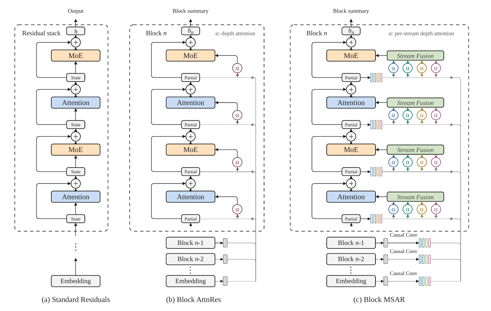
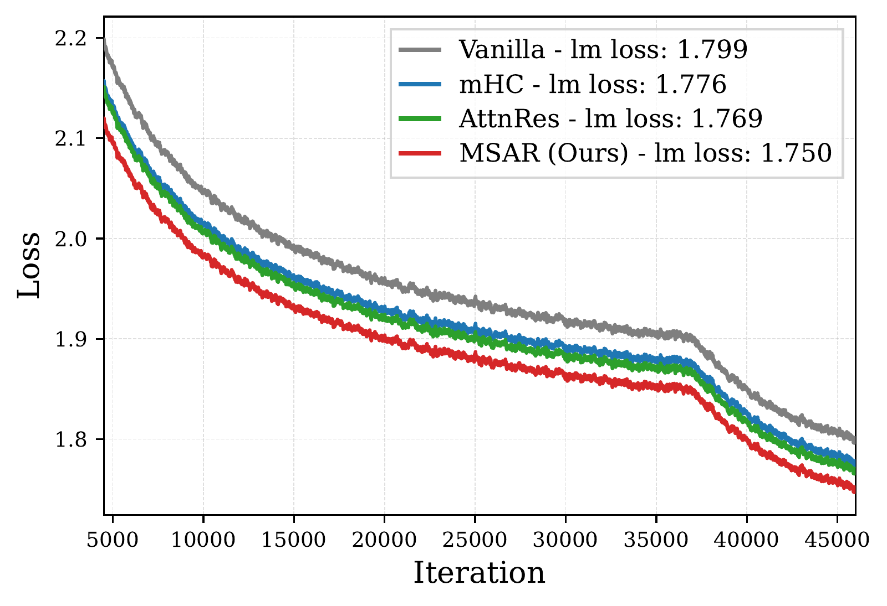
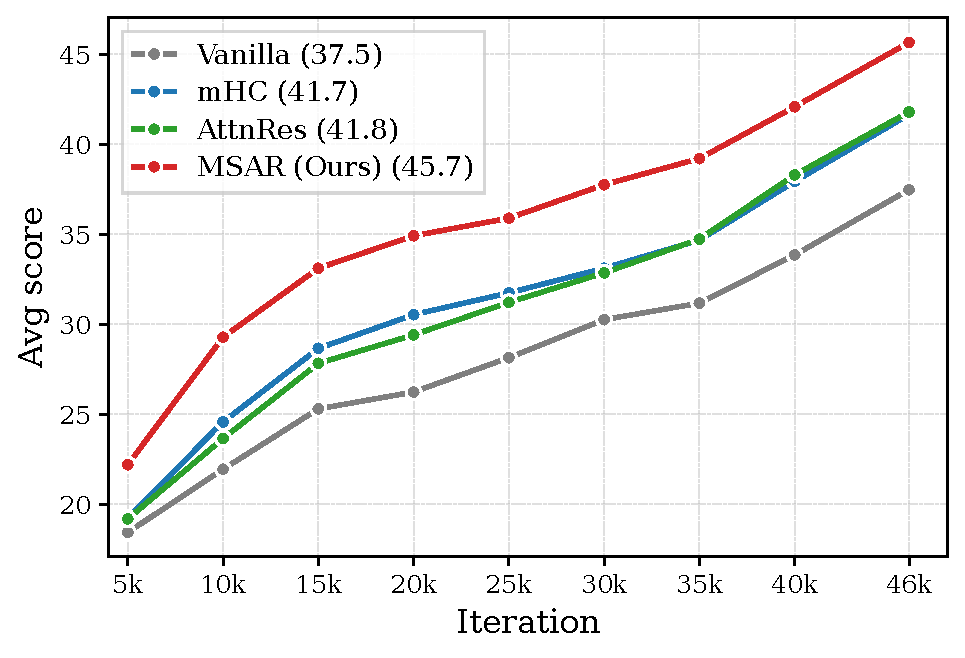
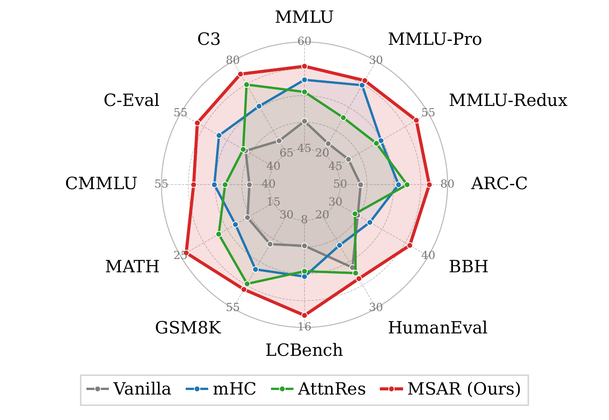
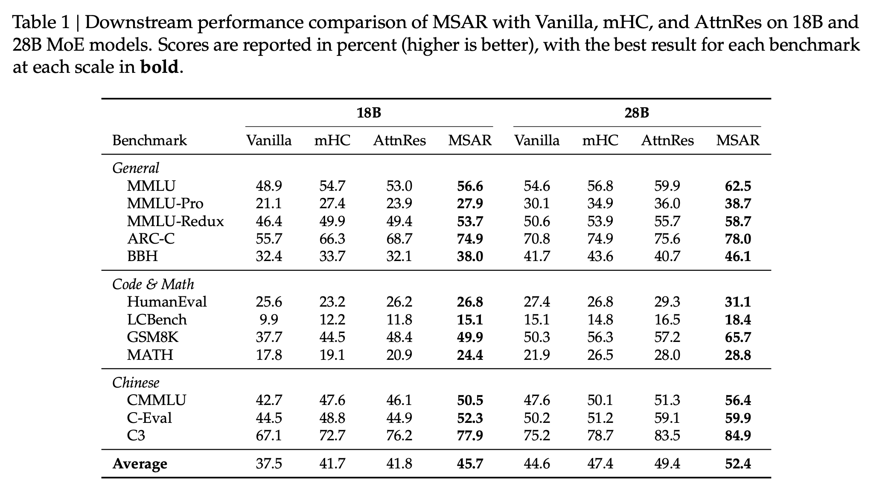
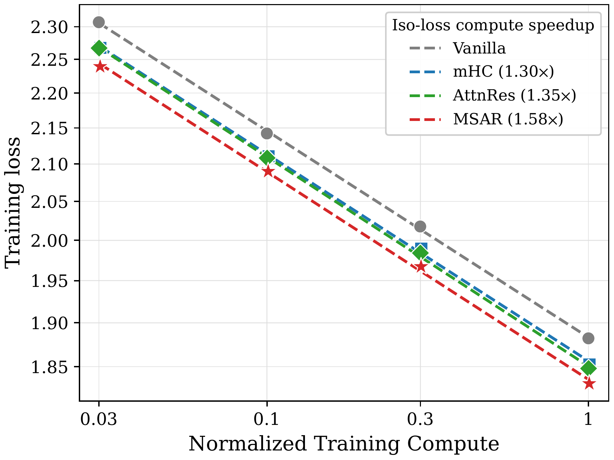
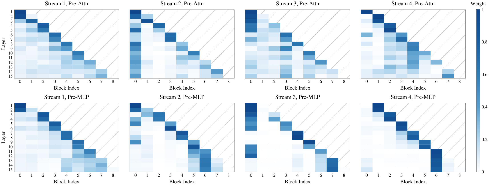

<h1 align="center">Multi-Stream Attention Residuals</h1>

<p align="center">
  <b>Multi-head depth attention from multi-scale sequence context</b>
</p>

<p align="center">
  Xiaohan Qin<sup>1,2,3</sup>, Xiangdong Zhang<sup>1,3</sup>, Tuo Dai<sup>3</sup>,
  Sunan Zou<sup>3,4</sup>, Huaijin Wu<sup>1,3</sup>,<br>
  Yebin Yang<sup>1,3</sup>, Zhuo Xia<sup>1,3</sup>, Lin Yao<sup>3</sup>, Yuliang Liu<sup>5</sup>,
  Junchi Yan<sup>1,&dagger;</sup>
</p>

<p align="center">
  <sup>1</sup>School of AI, Shanghai Jiao Tong University &nbsp;
  <sup>2</sup>Shanghai Innovation Institute<br>
  <sup>3</sup>Dots Studio, Xiaohongshu Inc. &nbsp;
  <sup>4</sup>School of CS, Peking University &nbsp;
  <sup>5</sup>Independent Researcher<br>
  <sup>&dagger;</sup>Corresponding author
</p>

<p align="center">
  <a href="https://arxiv.org/abs/2610.13630"><b>arXiv</b></a> &nbsp;|&nbsp;
  <a href="paper/MSAR.pdf"><b>PDF</b></a> &nbsp;|&nbsp;
  <a href="#overview">Overview</a> &nbsp;|&nbsp;
  <a href="#results">Results</a> &nbsp;|&nbsp;
  <a href="#citation">Citation</a>
</p>

**MSAR constructs multiple contextual views of each residual source, retrieves over depth independently for each stream, and adaptively fuses the retrieved states into a single layer input.** Block MSAR stores single-stream summaries and expands them on demand.

- **Consistent downstream gains:** MSAR outperforms Vanilla, mHC, and AttnRes on all 12 downstream benchmarks at both the 18B and 28B MoE scales.
- **Improved compute efficiency:** **1.58x** iso-loss compute speedup over standard residual connections, compared with **1.35x** for AttnRes and **1.30x** for mHC.
- **Low additional compute and parameter costs:** approximately **0.5%** training FLOPs and **0.3%** activated parameters in the 28B setting.


## Overview

Attention Residuals enables content-dependent retrieval over network depth. MSAR extends this retrieval to multiple heads by drawing source diversity from neighboring sequence positions, rather than splitting the hidden representation into disjoint feature slices.

<p align="center">
  <a href="assets/pdf/architecture.pdf"></a>
</p>

MSAR has three components:

1. **Multi-stream source expansion.** Multi-scale causal depthwise convolutions construct contextual views of each source. The default configuration uses one identity stream and three convolutional streams with kernel sizes **4, 8, and 12**.
2. **Per-stream depth attention.** Each target layer has a learned pseudo-query for each stream and independently retrieves from the corresponding historical source views.
3. **Adaptive stream fusion.** A lightweight, input-dependent scalar mixer aggregates the retrieved states into a single layer input.

**Block MSAR accumulates layer outputs before stream expansion.** Only single-stream block summaries need to persist or cross pipeline stages. Multi-stream views are reconstructed when depth attention is computed, retaining Block AttnRes's persistent source-storage and pipeline-communication scaling. The design also supports cross-stage caching and two-phase computation.

## Results

### Pre-training and Downstream Performance

<table>
  <tr>
    <td align="center" width="33%"><a href="assets/pdf/training_loss_18b.pdf"></a></td>
    <td align="center" width="33%"><a href="assets/pdf/avg_score_18b.pdf"></a></td>
    <td align="center" width="33%"><a href="assets/pdf/benchmarks_18b.pdf"></a></td>
  </tr>
  <tr>
    <td align="center">(a) Training loss</td>
    <td align="center">(b) Average downstream score</td>
    <td align="center">(c) Per-benchmark performance</td>
  </tr>
</table>

| Method | 18B final training loss (lower is better) | 18B average score | 28B average score |
| :--- | ---: | ---: | ---: |
| Vanilla | 1.799 | 37.5 | 44.6 |
| mHC | 1.776 | 41.7 | 47.4 |
| AttnRes | 1.769 | 41.8 | 49.4 |
| **MSAR** | **1.750** | **45.7** | **52.4** |

The average covers 12 benchmarks in general capabilities, code and mathematics, and Chinese language understanding, with detailed results shown in Table 1 below.

<p align="center">
  <a href="assets/downstream_results_18b_28b.png"></a>
</p>

### Scaling Laws

<p align="center">
  <a href="assets/pdf/scaling_laws.pdf"></a>
</p>

Training compute is normalized by the Vanilla training FLOPs at the largest evaluated model scale, using the same reference for all methods.

MSAR achieves the lowest training loss at all four evaluated scales. Its average iso-loss compute speedup over Vanilla is **1.58x**, compared with **1.35x** for AttnRes and **1.30x** for mHC. At the largest scale, the training-loss reductions relative to Vanilla are **2.7%**, **1.8%**, and **1.6%**, respectively.

### Component Studies

The 10B ablations isolate the contributions of contextual source expansion and adaptive fusion:

| Variant | Pile loss (lower is better) |
| :--- | ---: |
| AttnRes | 1.867 |
| AttnRes + mHC | 1.861 |
| MSAR without convolutional expansion | 1.862 |
| MSAR with mean aggregation instead of adaptive fusion | 1.851 |
| **MSAR (default)** | **1.847** |

Removing convolutions preserves four queries but makes the source streams identical. The resulting degradation supports the value of contextual source diversity beyond query diversity alone. Full stream-count and block-size ablations are in Table 2 of the [report](paper/MSAR.pdf).

<details>
<summary><b>Learned per-stream depth-attention patterns</b></summary>

<p align="center">
  <a href="assets/pdf/attention_patterns.pdf"></a>
</p>

Token-averaged attention weights from the 10B Block MSAR model. The four streams develop distinct source preferences; Pre-Attn and Pre-MLP reads also exhibit different access patterns. See Appendix D for the analysis.

</details>

## Citation

```bibtex
@misc{qin2026multistreamattentionresiduals,
      title={Multi-Stream Attention Residuals},
      author={Xiaohan Qin and Xiangdong Zhang and Tuo Dai and Sunan Zou and Huaijin Wu and Yebin Yang and Zhuo Xia and Lin Yao and Yuliang Liu and Junchi Yan},
      year={2026},
      eprint={2610.13630},
      archivePrefix={arXiv},
      primaryClass={cs.CL},
      url={https://arxiv.org/abs/2610.13630},
}
```

## Contact

For questions about the paper, please contact ```galaxy-1@sjtu.edu.cn```.
